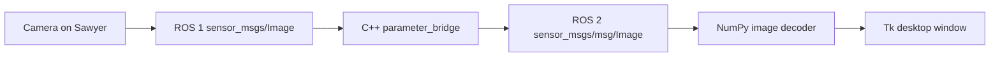

# Sawyer camera controls and desktop video

The camera viewer supports head/hand selection, simultaneous streams and explicit
stream shutdown. Commands affect only camera streaming; they send no joint commands.
The installed package uses existing system Humble and privately bundled ROS 1
clients. No Noetic/Humble Conda environments are required.

## Start the bridge and viewer

Install the package as documented in [README](../README.md#install-on-a-users-machine).
Initialize each terminal with:

```bash
source /opt/ros/humble/setup.bash
source "$CONDA_PREFIX/local_setup.bash"
# Set your existing ROS_MASTER_URI, ROS_IP and ROS_DOMAIN_ID from README.
```

**Terminal 1:** stop any existing bridge, then run:

```bash
ros2 launch sawyer_ros2_control bridge.launch.py cameras:=true
```

For joint control in the same session, add `commands:=true` to that launch.
Camera selection does not enable the robot or move its joints.

**Terminal 2:** after the same initialization, start the viewer.

Choose one of these commands:

```bash
# Select head, stop hand, open one head-camera pane.
ros2 run sawyer_ros2_control camera_viewer --camera head

# Select hand, stop head, open one hand-camera pane.
ros2 run sawyer_ros2_control camera_viewer --camera hand

# Explicitly start both sources and display two panes.
ros2 run sawyer_ros2_control camera_viewer --start-both

# Display existing streams without starting or stopping either source.
ros2 run sawyer_ros2_control camera_viewer
```

The default is read-only. `--camera head/hand` changes the robot's stream selection;
`--start-both` explicitly enables concurrent camera IO. Add `--view-only` to a
head/hand command to choose a pane without changing the source state.

Python alternative inside the same shell:

```bash
python -m sawyer_ros2_control.camera_viewer --camera head
```

## Switch without opening another window

Start the default two-pane viewer in the background:

```bash
ros2 run sawyer_ros2_control camera_viewer &
```

Then select a source from the same terminal:

```bash
ros2 run sawyer_ros2_control camera_viewer --camera head --select-only
ros2 run sawyer_ros2_control camera_viewer --camera hand --select-only
ros2 run sawyer_ros2_control camera_viewer --start-both --select-only
```

Run one selection command at a time. The existing viewer automatically displays
new frames; it never issues camera commands itself. A single-pane window stays
subscribed to its selected topic; use the two-pane viewer when switching sources.

## End the live stream

Closing the window with **Q**, **Esc**, the close button or **Ctrl-C** ends viewing.
By default, it leaves the robot's camera streaming.

To stop acquisition on the robot and exit immediately:

```bash
ros2 run sawyer_ros2_control camera_viewer --stop-stream head
ros2 run sawyer_ros2_control camera_viewer --stop-stream hand
ros2 run sawyer_ros2_control camera_viewer --stop-stream all
```

These commands do not close another viewer process; its stopped pane becomes
STALE or WAITING. To stop streams automatically when closing this viewer:

```bash
ros2 run sawyer_ros2_control camera_viewer --camera head --stop-on-exit
ros2 run sawyer_ros2_control camera_viewer --start-both --stop-on-exit

# View both for 30 seconds, then stop both and close automatically.
ros2 run sawyer_ros2_control camera_viewer --start-both --duration 30 --stop-on-exit
```

`--stop-on-exit` applies to the selected camera, or both when using `--start-both`.
Normal close, Ctrl-C and timed exit perform this cleanup. A force-killed process
cannot perform cleanup; use `--stop-stream all` afterward if needed.

## How video appears on the desktop

The Python node opens a **Tk window on the workstation's graphical desktop**.
It does not display video on Sawyer's face screen and does not create a web page.
Without a desktop display, use `--headless --duration 6`.



Humble Python subscribes to images with best-effort QoS and queue depth 1.
A background ROS executor stores the newest frame; the main thread decodes and
renders it. NumPy honors row padding and byte order, converts BGRA/RGB/mono to an
RGB preview, and Tk displays binary PPM pixels. No OpenCV or `cv_bridge` is needed.

The label shows receive FPS, source resolution and encoding. **LIVE** means fresh
frames; **WAITING** means none arrived; **STALE** means no frame for two seconds;
**ERROR** means the image could not be decoded. Stale pictures are removed.

Preview settings:

```bash
# Default: head above hand, in two rows; & frees the terminal.
ros2 run sawyer_ros2_control camera_viewer --start-both &

# Optional: head and hand side by side, in two columns.
ros2 run sawyer_ros2_control camera_viewer --start-both --layout columns &

# Smaller stacked previews for a desktop with limited screen height.
ros2 run sawyer_ros2_control camera_viewer --start-both --width 480 --height 320 --fps 10
```

`--layout rows` is the default; `--layout columns` selects side-by-side panes.
A single-camera view uses one pane with either layout. The layout applies when
opening the window; close and restart the viewer to change it.

Drag the window borders or maximize it: both panes expand or shrink, and the
images scale to fit while preserving aspect ratio. Frames stay centered with
black margins when the pane and image shapes differ. Resizing also redraws the
last frame when no new frame has arrived. Initial window size fits the desktop.

`--width/--height` set the requested initial pane size (640×480 by default).
In headless mode they cap preview dimensions without upscaling. Desktop resizing
changes only preview pixels, not camera capture settings. By default the viewer
performs at most 15 display refreshes/s. `--fps` accepts 1–60;
it limits GUI refresh only. It cannot make a 5 FPS source produce 60 distinct
frames.

## Can two cameras or two nodes stream simultaneously?

**Yes, both built-in cameras produced images concurrently on this robot.**
The SDK convenience method `Cameras.start_streaming()` stops the other camera
before starting the selected one. That is its software policy; it does not prove
the controller cannot deliver two streams. [Official SDK behavior](https://rethinkrobotics.github.io/intera_sdk_docs/5.1.0/intera_interface/html/intera_interface.camera.Cameras-class.html)

The explicit `--start-both` option uses the same camera IO `set` protocol with
`camera_streaming=true` on each camera independently. A private ROS 1 helper checks
command timestamps in the controller acknowledgements and the resulting state.
The bridge and ROS 2 viewer can already handle both Image topics.

For two separate nodes/windows, first enable both sources once:

```bash
ros2 run sawyer_ros2_control camera_viewer --start-both --select-only
ros2 run sawyer_ros2_control camera_viewer --camera head --view-only &
ros2 run sawyer_ros2_control camera_viewer --camera hand --view-only &
```

These nodes have distinct head/hand names. `--view-only` is essential here:
normal `--camera head/hand` follows single-camera selection and stops the other
source. Merely adding subscribers does not start an inactive camera.

Concurrent streaming was verified in short tests on this controller, not certified
for every Intera version or a prolonged workload. Both feeds have independent
timestamps; they are not a synchronized stereo pair. CPU, network load and
exposure can affect delivered FPS. If another program uses the SDK convenience
switch, it can stop one of the streams.

## Camera types, pixels, color and FPS

Read-only controller configuration and live ROS images supplied these values on
2026-10-12. The measured rates below are from a six-second concurrent ROS 1 sample;
they describe delivered frames, not the cameras' rated maximums.

| Property | Head camera | Right-hand camera |
|---|---|---|
| Controller driver | `ienso_ethernet` / `IensoCameraDevice` | `cognex` / `CognexCameraDevice` |
| Configured and observed source size | 1280×800 | 752×480 |
| Pixels per frame | 1,024,000 ≈ 1.024 MP | 360,960 ≈ 0.361 MP |
| Image color | Color | Grayscale |
| Observed rectified encoding | `bgra8`: 8-bit B/G/R/A, 4 bytes/pixel | `mono8`: 8-bit gray, 1 byte/pixel |
| Controller `fps` setting | 10 | 10 |
| Measured concurrent receive rate | 7.23 FPS; 41 frames | 4.76 FPS; 29 frames |
| Verified hardware maximum FPS | **Unknown; not exposed by the controller** | **Unknown; not exposed by the controller** |
| Verified maximum sensor resolution | **Unknown; current output is 1280×800** | **Unknown; current output is 752×480** |

The head's alpha channel is discarded for display. The hand sensor supplies
monochrome pixels; copying gray into three RGB channels cannot recover real
color. Two-node processing does not change either sensor's color capability.

Do not interpret configured `fps: 10` as a proven hardware maximum. Exact sensor
part numbers and supported acquisition modes are not supplied by the current
configuration. A model-specific vendor datasheet or controller documentation is
needed to certify maximum FPS/resolution. This change leaves FPS, resolution,
exposure, gain and onboard configuration files untouched.

Inspect current settings and rates yourself:

```bash
ros2 run sawyer_ros2_control camera_viewer --stream-info \
  --report "${SAWYER_STATE_DIR:-$HOME/.local/state/sawyer_ros2}/camera-info.json"
```

This samples existing ROS 1 streams for three seconds and changes no camera state.
To check ROS 2 delivery after explicitly starting both:

```bash
ros2 run sawyer_ros2_control camera_viewer --start-both --headless --duration 6 \
  --require-both --stop-on-exit --report "${SAWYER_STATE_DIR:-$HOME/.local/state/sawyer_ros2}/camera-video.json"
```

## Implementation and validation

- `camera_viewer.py`: Humble subscriptions, CLI, NumPy decoding and Tk display.
- `scripts/camera_control.py`: isolated private ROS 1 IO control and read-only information;
  standard ROS 1 packages only, with bounded waits and acknowledgement checks.
- `config/sawyer_bridge.yaml`: opt-in, one-way head/hand image forwarding.
- No new shell wrappers or dependencies; existing motion logic is unchanged.

Unit, simulated and physical camera results are recorded in
[camera_options_validation.json](results/conda/camera_options_validation.json).
Tests distinguish simulated images, real camera IO and real ROS 2 image delivery.
The hardware test restores the stream state observed before the test and sends
no robot movement commands.
