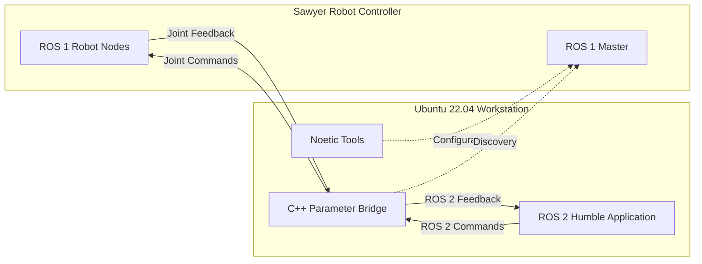
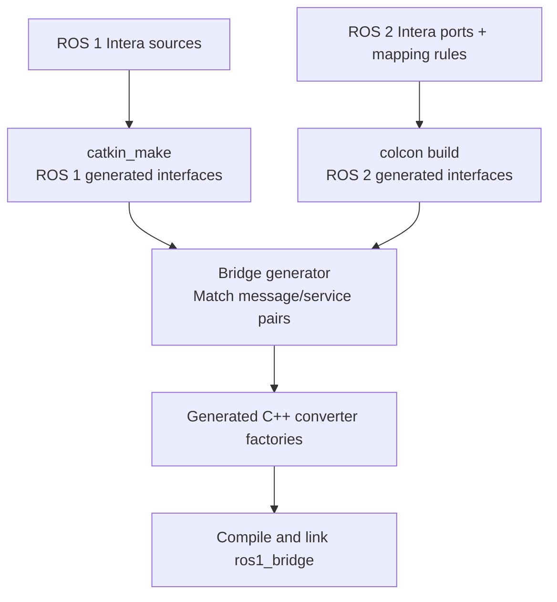
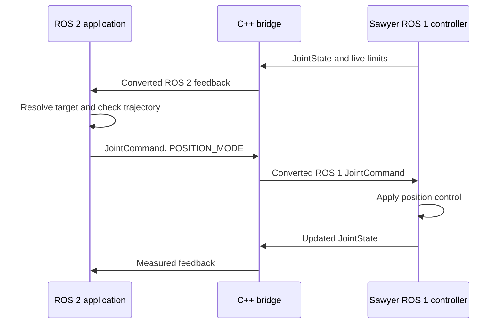

# How the Sawyer bridge works with Conda

This guide explains the implementation in the `conda` branch. Use the
[README](../README.md) for installation and operating commands, and
[MIGRATION.md](../MIGRATION.md) for recorded validation results.

## 1. What runs where

Sawyer keeps its existing ROS 1 controller. The workstation runs ROS 1 tools,
a C++ bridge, and ROS 2 applications. Conda supplies their dependencies.

## Sawyer ROS 1 - ROS 2 Bridge Architecture

## Sawyer ROS 1–ROS 2 Bridge Architecture

## Sawyer ROS 1–ROS 2 Bridge Architecture



There is one bridge executable participating in both ROS graphs. Its ROS 1
side uses `roscpp`; its ROS 2 side uses `rclcpp` and the ROS 2 middleware.
Conda environments are directories containing interpreters, tools and libraries.
Processes communicate through ROS networking, rather than through Conda itself.

The robot remains responsible for actuator control. The workstation application
produces position references; the bridge translates and forwards messages.

## 2. Why two Conda environments are used

| Environment prefix | Provides | Used for |
|---|---|---|
| `.conda/envs/noetic` | ROS 1 libraries, tools and message generators | Catkin interfaces, `rospy` diagnostics and bridge configuration |
| `.conda/envs/humble` | ROS 2 libraries, tools, generators and compiler | ROS 2 interfaces, applications, launch and the bridge |

Both use **Python 3.12.15** and **NumPy 2.5.3**, as specified in
[the Humble YAML](../environment.yml) and [the Noetic YAML](../environment-noetic.yml).
These are RoboStack builds of ROS for Conda. Their Python version differs from
the usual system installations of Noetic and Humble.

Separate environments keep each distro's Python packages and build metadata
available in its own prefix. For example, both distros provide packages named
`std_msgs`, but their generated types and CMake configuration are different.
The bridge needs selected parts of both, in a deliberate search order.

System Humble under `/opt/ros/humble` uses Python 3.10 on this workstation.
Mixing its Python paths into these Python 3.12 environments can select incompatible
bindings. RoboStack also documents interference from sourcing system ROS into
Conda environments. [RoboStack environment guidance](https://robostack.github.io/GettingStarted.html).

### Dependency specifications versus exact locks

The two YAML files describe the direct dependencies. The
[explicit locks](../config/conda/) list the exact package builds and checksums
used in validation, including transitive dependencies such as Boost and libstdc++.

Creating an environment from the lock reproduces that package selection.
Creating it from YAML runs a fresh solver and can change transitive packages.
The recorded runtime tests used the locks; the YAML alternatives were checked
for successful dependency solving.

Conda installation alone does not build this repository's custom messages or
its customized bridge. Those require the three workspace builds below.

## 3. How `env.sh` initializes a process

[`scripts/env.sh`](../scripts/env.sh) supports three project modes:

| Mode | Initial ROS setup | Project overlay | Additional paths |
|---|---|---|---|
| `ros1` | Noetic prefix `setup.bash` | `ros1_ws/devel_conda/setup.bash` | EmPy compatibility module |
| `ros2` | Humble prefix `setup.bash` | `ros2_ws/install_conda/local_setup.bash` | EmPy compatibility module |
| `bridge` | Humble prefix `setup.bash` | ROS 2 interfaces and built bridge | Selected ROS 1 tools, interfaces and libraries |

An **overlay** is a built workspace added to an existing ROS installation so
its packages can be found. The Conda prefix is the underlying installation;
the workspace overlay supplies this project's Intera types and applications.

For each invocation, the script:

1. Locates the repository and exports `SAWYER_ROOT`.
2. Clears inherited Python, ROS, compiler and library search paths.
3. Selects the requested Conda prefix and places its tools first on `PATH`.
4. Sources that prefix's ROS setup and any existing project overlay.
5. Adds mode-specific paths, then executes the command or opens a shell.

`PYTHONNOUSERSITE=1` also prevents user site-packages from entering this process.
This makes the environment independent of unrelated ROS sourcing in a parent shell.

A normal `conda activate` can run RoboStack's packaged ROS activation hooks.
The project wrapper instead selects the prefix and sources the required ROS
setup explicitly; it does not call `conda activate` internally. This gives it
control over the bridge's mixed search paths. [RoboStack Conda activation](https://robostack.github.io/conda.html).

### Interactive shell versus one command

From the repository root:

```bash
./scripts/env.sh ros2
```

opens a `[sawyer ros2]` shell and automatically loads `config/network.env` when
it exists. The parent shell returns when you type `exit`.

A one-command invocation uses the caller's network variables:

```bash
source config/network.env
./scripts/env.sh ros1 python scripts/preflight.py
```

This distinction lets tests supply their own localhost master without having
it overwritten by the robot configuration. Execute `env.sh`; do not source it.
The `system-ros2` mode is a separate diagnostic mode for system Python 3.10.

## 4. Why the bridge has a mixed library environment

`bridge` mode starts from Humble, then adds only the Noetic components needed
by the existing bridge. There is no third Conda environment to create.

| Variable | What it selects |
|---|---|
| `PATH` | Humble tools first, then Noetic tools such as `rosmsg` and `rossrv` |
| `ROS_PACKAGE_PATH` | ROS 1 interface sources and Noetic package descriptions |
| `PKG_CONFIG_PATH` | ROS 1 custom-package metadata and Noetic libraries |
| `PYTHONPATH` | ROS 1 interfaces for bridge generation, alongside the ROS 2 setup paths |
| `CMAKE_PREFIX_PATH` | ROS 2 custom interfaces, Humble, then Noetic |
| `LD_LIBRARY_PATH` | Humble libraries first, then ROS 1 workspace and Noetic libraries |
| `xmlrpcpp_DIR` | The ROS 1 XML-RPC CMake configuration |
| `CC`, `CXX` | Humble's Conda C/C++ compiler executables |

CMake prefixes tell the build where package configuration lives. Library paths
tell the runtime loader where shared libraries live. Python paths tell the
generator where interface descriptions and helper modules live. They solve
separate discovery problems.

Ordering matters: placing the complete Noetic prefix first could make a ROS 2
build find a ROS 1 package with the same name. The wrapper preserves ROS 2-first
CMake/library ordering while giving ROS 1 discovery explicit paths.

The bridge generator also temporarily removes ROS 2 Python paths when invoking
`rosmsg` and `rossrv`. See
[`find_ros1_interface_packages.cmake`](../bridge_ws/ros1_bridge/cmake/find_ros1_interface_packages.cmake).
ROS 1 library discovery uses pkg-config through
[`find_ros1_package.cmake`](../bridge_ws/ros1_bridge/cmake/find_ros1_package.cmake).

The tested package locks keep the compiled-library combination reproducible.
Changing Python, Boost, NumPy, libstdc++ or environment prefixes requires rebuild
and validation; a successful import of one module does not prove bridge compatibility.

## 5. What the three workspace builds produce



### ROS 1 workspace

`ros1_ws/src` links to the original `intera_core_msgs` and `intera_motion_msgs`
packages under `intera_common`. Catkin generates ROS 1 Python classes, C++
headers and package metadata into `ros1_ws/devel_conda`.

### ROS 2 workspace

`ros2_ws/src` contains the ROS 2 Intera ports plus `sawyer_ros2_control`.
Ament/rosidl generates Python classes, C++ types and compiled typesupport.
Typesupport allows ROS 2 to serialize messages and communicate through its
middleware. Installed packages are under `ros2_ws/install_conda`.

### Bridge workspace

The active source is **`bridge_ws/ros1_bridge`**. Build it after both interface
workspaces. Its Python generator inspects both sets of interfaces and their
mapping rules, emits C++ factories, and links them into the bridge library.
The executable and library are installed under `bridge_ws/install_conda`.

Supported message and service conversions must be available when this C++
bridge is compiled. Adding a custom interface later requires rebuilding its
workspaces and reconfiguring/rebuilding the bridge.
[Upstream custom-interface requirements](https://github.com/ros2/ros1_bridge).

`SAWYER_BUILD=1` tells the wrapper to avoid loading an existing bridge overlay
while rebuilding it. Full build commands are in the [README](../README.md#build).

### EmPy compatibility

Legacy generators require EmPy 3.3.4, while the installed dependency sets include
EmPy 4.2.1. `tools/empy3` provides the licensed pure-Python compatibility module.
`python_noetic.sh` keeps it first even inside catkin's cached build environment.
The bridge executable is C++; Python and EmPy are used to generate its converters.

## 6. How custom message mappings work

Matching a topic name does not make ROS 1 and ROS 2 message representations
interchangeable. The bridge needs a supported pair of types and conversions.

For example:

| Purpose | ROS 1 type | ROS 2 type |
|---|---|---|
| Joint feedback | `sensor_msgs/JointState` | `sensor_msgs/msg/JointState` |
| Arm command | `intera_core_msgs/JointCommand` | `intera_core_msgs/msg/JointCommand` |
| Robot state | `intera_core_msgs/RobotAssemblyState` | `intera_core_msgs/msg/RobotAssemblyState` |

ROS 2 field names must follow its naming rules. The original ROS 1 field
`lowVoltage` becomes `low_voltage` in the ROS 2 port. The
[core mapping file](../ros2_ws/src/intera_core_msgs/bridge_mapping.yaml)
explicitly associates those fields so the state value survives conversion.

JointCommand retains its field names and semantics:

```text
header
mode
names[]
position[]
velocity[]
acceleration[]
effort[]
```

The selected name and position arrays correspond by index. The application uses
`POSITION_MODE = 1`, with positions in radians. In position mode, its velocity,
acceleration and effort command arrays remain empty.

The existing bridge modifications support directional topics, enabled flags,
service field renames, time/duration conversions, bool arrays and empty arrays.
These are part of the included source; they do not require a separate patch step.

## 7. What happens when the launch command runs

```bash
cd ~/sawyer_rs
source config/network.env
./scripts/env.sh ros2 ros2 launch sawyer_ros2_control bridge.launch.py
```

The [launch file](../ros2_ws/src/sawyer_ros2_control/launch/bridge.launch.py)
starts processes in this order:

1. An isolated **Noetic Python process** runs `configure_bridge.py`.
2. That process loads `config/sawyer_bridge.yaml` and writes ROS 1 parameters:
   `/sawyer_bridge/topics`, `/sawyer_bridge/services_1_to_2` and
   `/sawyer_bridge/services_2_to_1`.
3. Once configuration exits successfully, an isolated **bridge process** starts
   the existing C++ `parameter_bridge` executable.
4. The executable reads those ROS 1 parameters and creates the selected endpoints.

The YAML is a project configuration loaded into the **ROS 1 parameter server**.
The parameter names are positional arguments to `parameter_bridge`; they are
not ROS 2 `--params-file` arguments. The launch file is an orchestrator; it does
not relay messages itself. A configuration failure prevents bridge startup.

The ROS 2 node appears as `ros_bridge`. The launch also supplies a ROS 1 node-name
remapping; ROS 1 and ROS 2 names do not have to be identical.

### Selecting command paths

The default launch leaves arm commands disabled. After operator approval,
stop that launch and restart it with:

```bash
./scripts/env.sh ros2 ros2 launch sawyer_ros2_control bridge.launch.py commands:=true
```

The configuration helper enables the arm's joint-command, command-timeout and
speed-ratio topics in the uploaded parameters. It does not rewrite the YAML file
or publish a movement. `head_commands:=true` is a separate option for the head.
Robot enable remains disabled in the default configuration.

### Forwarding camera images

`cameras:=true` enables two additional ROS 1 → ROS 2 `sensor_msgs/Image` paths:
head `image_rect_color` and right-hand `image_rect`. It changes only forwarding,
with best-effort ROS 2 QoS and queue depth 1 so old frames do not accumulate.
The existing bridge build already includes the standard Image converter.

`camera_viewer` runs entirely in Humble. It subscribes to both ROS 2 image topics,
decodes pixels using NumPy, and displays two Tk panes. The ROS executor stores the
latest message on a background thread; Tk renders on the main thread. Python,
NumPy and Tk all come from the same Conda environment; no Noetic Python or
`cv_bridge` extension is imported into the viewer.

Default viewing does not control either camera. Explicit `--camera head/hand`,
`--start-both`, and `--stop-stream` options call `scripts/camera_control.py` through
`env.sh ros1` in a separate Noetic process. It uses the SDK camera IO command
protocol and waits for acknowledgement; ROS 1 Python is never imported into the
Humble viewer. Closing only stops viewing unless `--stop-on-exit` was requested.

The SDK convenience switching API stops the other camera, but both physical
streams were delivered concurrently through direct camera IO on this controller.
See [camera controls, desktop display and measured specifications](CAMERAS.md).

## 8. Topic directions and endpoint roles

The selected topic policy is in
[`config/sawyer_bridge.yaml`](../config/sawyer_bridge.yaml).

| Topic | Direction | Bridge's ROS 1 role | Bridge's ROS 2 role | Default |
|---|---|---|---|---|
| `/robot/joint_states` | `1to2` | Subscriber | Publisher | Enabled |
| `/robot/state` | `1to2` | Subscriber | Publisher | Enabled |
| `/robot/limb/right/endpoint_state` | `1to2` | Subscriber | Publisher | Enabled |
| `/robot/limb/right/collision_detection_state` | `1to2` | Subscriber | Publisher | Enabled |
| `/robot/joint_limits` | `1to2` | Subscriber | Publisher | Enabled |
| `/robot/head/head_state` | `1to2` | Subscriber | Publisher | Enabled |
| `/robot/limb/right/joint_command` | `2to1` | Publisher | Subscriber | Disabled |
| `/robot/limb/right/joint_command_timeout` | `2to1` | Publisher | Subscriber | Disabled |
| `/robot/limb/right/set_speed_ratio` | `2to1` | Publisher | Subscriber | Disabled |
| `/robot/head/command_head_pan` | `2to1` | Publisher | Subscriber | Disabled |
| `/io/internal_camera/head_camera/image_rect_color` | `1to2` | Subscriber | Publisher | Disabled |
| `/io/internal_camera/right_hand_camera/image_rect` | `1to2` | Subscriber | Publisher | Disabled |

These roles explain why command-topic information shows the bridge as a ROS 2
**subscriber**, while joint-state information shows it as a ROS 2 **publisher**.
The implementations are in
[`parameter_bridge.cpp`](../bridge_ws/ros1_bridge/src/parameter_bridge.cpp) and
[`bridge.cpp`](../bridge_ws/ros1_bridge/src/bridge.cpp).

Using explicit directions creates only the required forwarding endpoints.
Disabled entries create no endpoints. Entries without a direction retain the
upstream bidirectional behavior for compatibility with `config/bridge.yaml`.

## 9. How joint-state feedback reaches your program

For `/robot/joint_states`, the path is:

1. Sawyer publishes a ROS 1 `sensor_msgs/JointState`.
2. The bridge's ROS 1 subscriber receives it.
3. A compiled converter translates the ROS 1 representation into ROS 2.
4. The bridge publishes a ROS 2 `sensor_msgs/msg/JointState` on the same topic name.
5. `rclpy` delivers it to your ROS 2 application's callback.

Sawyer can publish arm, head and gripper subsets on this topic. The bridge
forwards messages individually; it does not combine them. The guarded application
merges arm subsets and tracks their freshness. `move_joint` selects feedback
containing the requested joint.

The standard Header conversion preserves timestamp/frame ID semantics. ROS 2
Header has no ROS 1 sequence field, so interface conversion is not a claim that
all serialized bytes on the two protocols are identical.

## 10. How a joint command reaches Sawyer

Once arm command transport is enabled:



`move_joint` reads feedback and live limits, resolves a relative/absolute target,
and generates a quintic position reference. It publishes at roughly 100 Hz.
For an arm joint, a typical reference message has:

```text
mode: 1
names: [right_j2]
position: [current_reference_in_radians]
velocity: []
acceleration: []
effort: []
```

The bridge's ROS 2 subscription converts each message and publishes it to
Sawyer's ROS 1 `/robot/limb/right/joint_command` subscribers. The robot executes
its controller logic, and feedback returns through the opposite path.

The bridge forwards individual references. Trajectory timing, limit checks and
arrival detection belong to the application. A requested duration describes the
reference trajectory; the measured result still depends on the controller and
fresh feedback.

For `--position +end`, the single-joint application resolves the upper bound of
the intersected live and model limits. A six-second request must still pass its
minimum-duration calculation. The bridge does not interpret `+end` or plan motion.

## 11. Why `ros2 run` and `python` use the same movement logic

These examples are **dry runs** and publish no robot commands:

```bash
# In the initialized [sawyer ros2] shell:
ros2 run sawyer_ros2_control move_joint --joint right_j2 --distance 0.01 --time 5 --dry-run
python "$SAWYER_ROOT/scripts/move_joint.py" --joint right_j2 --distance 0.01 --time 5 --dry-run
```

`ros2 run` looks up the installed package executable. Its console entry point,
defined in [setup.py](../ros2_ws/src/sawyer_ros2_control/setup.py), calls
`sawyer_ros2_control.move_joint:main`. That module is a relative link to
`scripts/move_joint.py`.

The direct Python command runs that source file, whose `__main__` block calls
the same `main()` function. It still creates a ROS 2 node and uses `rclpy`.
It needs generated messages and the package resources supplied by the ROS 2
overlay, including `joint_limits.json`.

The installed executable uses its recorded interpreter; the direct command uses
`python` on the shell's `PATH`. In the intended environment, both select the
project's Humble Python. Omitting `--dry-run` enables the single-joint program's
execution path, so use the README's approval/readiness procedure for physical tests.

### Single-joint versus guarded application

| Behavior | `move_joint` | `command` |
|---|---|---|
| Planning only | Requires `--dry-run` | Default for motion operations |
| Commanded arm names | Selected joint | All seven; unselected joints retain measured targets |
| Readiness/collision monitoring | Selected-joint feedback/limit checks | Full-arm readiness, collision and freshness checks |
| Arm speed setting | Explicitly sets ratio 1.0 | Default ratio 0.05 |
| Execution authorization | Execution path when dry-run omitted | Requires `--execute --operator-approved`, fresh preflight and transport proof |

A ratio of 1.0 permits the controller's configured position-rate limit; it does
not mean the quintic reference is automatically generated at maximum speed.
Neither application removes the robot's own controller safety mechanisms.

## 12. Networking and ROS 2 QoS

### Network variables

| Variable | Current configuration | Role |
|---|---|---|
| `ROS_MASTER_URI` | `http://169.254.121.3:11311` | ROS 1 graph discovery and parameter server |
| `ROS_IP` | `169.254.121.2` | Workstation address advertised to ROS 1 peers |
| `ROS_DOMAIN_ID` | `42` | DDS discovery domain for ROS 2 peers |
| `ROS_HOSTNAME` | Unset | Avoids conflicting ROS 1 address advertising |

The ROS 1 master coordinates discovery and configuration. Topic traffic travels
between node endpoints; master reachability alone does not prove that the robot
can connect back to the advertised workstation address. Verify the wired route
and use the actual PC address on a new machine.

ROS 2 applications must use a matching DDS domain and compatible QoS. The
robot's ROS 1 controller does not use `ROS_DOMAIN_ID`; the bridge's ROS 2 side does.

### QoS settings in this project

Joint states are published with best-effort reliability and a small queue.
A reliable-only subscriber cannot match that publisher. Subscribe using
best-effort QoS, as the application and documented echo command do.

Live limits use transient-local durability so compatible late subscribers can
receive the bridge's retained sample while it remains alive. Commands use
reliable, volatile delivery; the guarded publisher additionally gives commands
a 0.2-second lifespan. Lifespan concerns message expiration in DDS.
[Official ROS 2 QoS policies and compatibility](https://github.com/ros2/ros2_documentation/blob/humble/source/Concepts/Intermediate/About-Quality-of-Service-Settings.rst).

The ROS 1 `/robot/limb/right/joint_command_timeout` setting is a separate
controller watchdog. The guarded application publishes that setting; the
single-joint program does not configure it. A lifespan value displayed on a
bridge subscription is not proof that the controller timeout has been set.

## 13. Reading common errors correctly

### Feedback works, but there is no bridge command subscriber

The default launch enables telemetry only. A dry run can therefore read a
position and print a valid plan while the execution path has no command subscriber.
The single-joint program waits for both joint-command and speed-ratio subscriptions;
its error can name the joint-command topic when either connection is missing.

After an approved command-bridge restart, inspect both topics in the ROS 2 shell:

```bash
ros2 topic info /robot/limb/right/joint_command --verbose
ros2 topic info /robot/limb/right/set_speed_ratio --verbose
```

A bridge subscription with zero publishers means transport is available and no
application is currently publishing. It does not by itself verify robot readiness
or a valid ROS 1 controller subscriber.

### Controller state is ready, but preflight is not

[`preflight.py`](../scripts/preflight.py) checks the actual ROS 1 graph and
command subscriber types, feedback, live limits and controller state. Its final
readiness result includes the position-limit checks. A controller's `ready`
field can therefore be true while overall preflight readiness is false.

In the last reported example, `right_j6=-4.7138359375` was below its live lower
limit `-4.7124`. That is a readiness rejection, even though telemetry and command
transport are available. Resolve it through the operator's normal procedure;
the single-joint program's selected-joint checks are not the full-arm preflight.

### Interfaces exist, but the bridge has no converter

ROS 2 interface discovery proves that a package is installed. A converter also
requires both interface versions to have been visible during the bridge build.
Rebuild in the documented order and inspect compiled pairs:

```bash
cd ~/sawyer_rs
./scripts/env.sh bridge ros2 run ros1_bridge dynamic_bridge -- --print-pairs > .runtime/bridge-pairs.txt
/usr/bin/python3 scripts/check_pairs.py .runtime/bridge-pairs.txt
```

This use of `dynamic_bridge` prints available pairs and exits; normal operation
still uses the selective `parameter_bridge`.

## 14. Services, actions and validation boundaries

The bridge also contains the three Intera service converters. A configured ROS 2
service server can forward a request to an existing ROS 1 server and convert its
response. The default service lists are empty: a compiled converter is not an
automatically exposed service. In this checkout, `services_2_to_1` exposes an
existing ROS 1 service to ROS 2, as noted in the configuration comments.

ROS 2 action definitions are built, but this bridge does not provide full ROS
action goal/cancel/status interoperability. Interface generation alone does not
establish action support.

Recorded checks include both interface builds, native C++ conversions, all 46
Intera message mappings, three services, 34 unit tests, isolated command forwarding,
and physical read-only telemetry/FK/IK. Physical actuation was not performed
during migration. See [MIGRATION.md](../MIGRATION.md#validation-results) for the
results and [README position control](../README.md#position-control) for the
approved-test procedure.
