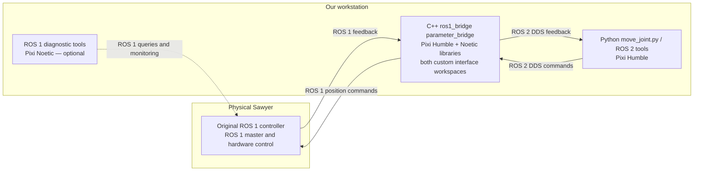

# How our Sawyer ROS 1 / ROS 2 setup works

The physical Sawyer still runs its original ROS 1 controller. Our workstation
runs a ROS 2 Python application and a C++ `ros1_bridge` process. The bridge
converts selected ROS messages between the two systems.

The Python application calculates the joint trajectory on the workstation.
Sawyer's onboard controller receives the resulting ROS 1 position commands and
drives the motors. The motor control and robot safety mechanisms remain onboard.

## Where each part runs

| Part | Location | Environment | What it does |
|---|---|---|---|
| Sawyer controller and ROS 1 master | Physical Sawyer controller | Original onboard ROS 1 software | Publishes robot feedback, receives commands and controls hardware. Its ROS distribution is not assumed to be workstation Noetic. |
| ROS 1 tools | Workstation | Pixi `noetic`, Python 3.12 | Builds original interfaces and runs tools such as `rostopic`, `rosmsg` and read-only diagnostics. |
| ROS 1 custom interfaces | `ros1_ws/devel` | Built using Pixi `noetic` and catkin | Supplies original Intera ROS 1 message/service types and libraries. |
| ROS 2 custom interfaces | `ros2_ws/install` | Built using Pixi `humble`, ament and rosidl | Supplies equivalent Intera ROS 2 message/service types and libraries. |
| `ros1_bridge parameter_bridge` | Workstation, `bridge_ws/install_sawyer` | Pixi `humble` with the required Noetic libraries and both interface workspaces | One C++ process participates in both ROS graphs and converts configured topics. |
| `scripts/move_joint.py` | Workstation | Pixi `humble`, Python 3.12 | Reads feedback, plans a quintic trajectory and publishes ROS 2 position commands. |
| System `/opt/ros/humble` | Workstation | System Python 3.10 | Separate diagnostic installation; the project's bridge and control application use Pixi Humble. |

`noetic` and `humble` are two Pixi environments defined in `pixi.toml`.
`bridge` is a mode of `scripts/env.sh`, not a third Pixi environment. It starts
from Pixi Humble and adds the specific ROS 1 libraries needed by the bridge.

The Noetic environment is not an extra relay between Sawyer and the bridge.
The bridge's ROS 1 side connects directly to Sawyer. A separate ROS 1 diagnostic
terminal is optional; it does not have to stay open for ROS 2 control to work.

## Connections



Two ROS graphs are involved:

- **ROS 1:** nodes use Sawyer's ROS master to discover publishers and
  subscribers. Topic data travels over ROS 1 connections such as TCPROS;
  the master provides discovery rather than relaying every message.
- **ROS 2:** the application and the ROS 2 side of the bridge discover each
  other through DDS. They must use the same `ROS_DOMAIN_ID` and compatible QoS.

In our recorded lab configuration, `config/network.env` supplies:

```bash
export ROS_MASTER_URI=http://169.254.121.3:11311
export ROS_IP=169.254.121.2
unset ROS_HOSTNAME
export ROS_DOMAIN_ID=42
```

`169.254.121.3` is the Sawyer controller, and `169.254.121.2` is the workstation.
`ROS_IP` tells ROS 1 peers how to contact workstation nodes. DDS domain 42 is
used by the workstation's ROS 2 application and bridge; Sawyer's ROS 1 controller
does not use that domain. These addresses must match the actual lab network.

We use the robot's existing master. The normal hardware workflow does not start
a second workstation `roscore`.

## How robot feedback reaches Python

For joint states, the path is:

```text
Sawyer publishes /robot/joint_states
    ROS 1 sensor_msgs/JointState
        -> bridge converts the message
    ROS 2 sensor_msgs/msg/JointState
        -> move_joint.py or ros2 topic echo receives it
```

The topic name stays the same on both graphs. The bridge converts the message
representation; it does not change the joint coordinate system or translate
angles into degrees. `move_joint.py` selects a joint position by its name in
the message, rather than assuming a fixed array index.

The selected configuration also forwards assembly state, endpoint state,
collision detection, joint limits and head state. Limits are published to ROS 2
with transient-local durability so an application starting later can receive
the ROS 1 latched limit information.

## How a ROS 2 command moves the arm

For example, when the operator runs:

```bash
python scripts/move_joint.py --joint right_j1 --position 0.0 --time 5
```

the application does the following:

1. Reads the selected joint's current position and controller limits through
   the bridge. It combines controller and URDF limits.
2. Resolves the target: absolute radians, a `pi` expression, `-end`, `+end`, or
   current position plus `--distance`.
3. Checks the target and minimum quintic time against the available velocity
   and acceleration limits.
4. Sets the arm's SDK position-control speed ratio to 1.0 through its configured
   ROS 2 → ROS 1 path, then publishes quintic position references at about 100 Hz.
5. Checks fresh measured feedback at the trajectory deadline and reports the
   actual final error. The default arrival tolerance is 0.008726646 rad; extra
   settling time is zero unless requested.

The command path is:

```text
move_joint.py publishes /robot/limb/right/joint_command
    ROS 2 intera_core_msgs/msg/JointCommand
        -> bridge converts the message
    ROS 1 intera_core_msgs/JointCommand
        -> Sawyer's /realtime_loop subscriber
        -> onboard position control and motors
```

Arm commands use `POSITION_MODE` and include only the selected joint name and
position. The workstation streams a position reference; Sawyer performs the
actuator control. The script does not enable the robot automatically.

Small measured overshoot at a limit is handled separately from command validity:
up to 0.008726646 rad of measured excursion is allowed, while all targets and
published commands remain strictly within limits. A recovery trajectory starts
its reference at the valid boundary. The raw measured angle remains in reports.

See [SINGLE_JOINT_CONTROL.md](SINGLE_JOINT_CONTROL.md) for complete arguments and
examples. Publishing stops when the application exits; the onboard controller
may retain the last position target.

## What the bridge startup command does

`pixi run bridge-start --commands` calls `scripts/start_bridge.sh`, which:

1. Loads `config/network.env` through the Pixi task.
2. Uses the Noetic runtime briefly to read `config/sawyer_bridge.yaml` and load
   its configuration into ROS 1 parameters under `/sawyer_bridge`.
3. Enables the arm command, command-timeout and speed-ratio paths for this run.
4. Starts the C++ `parameter_bridge` in the prepared Humble/ROS 1 library runtime.

The configuration-loading Python process exits. The bridge then stays running
as one process with both ROS 1 and ROS 2 connections. Its ROS 1 node name is
`/sawyer_selective_bridge`.

The YAML selects individual topics and directions. Our bridge has project
extensions for `direction` and `enabled`; these are not assumed to work with
every unmodified upstream `parameter_bridge` installation.

| Topic | Direction | Startup selection |
|---|---|---|
| `/robot/joint_states` | ROS 1 → ROS 2 | Default |
| `/robot/state` | ROS 1 → ROS 2 | Default |
| `/robot/limb/right/endpoint_state` | ROS 1 → ROS 2 | Default |
| `/robot/limb/right/collision_detection_state` | ROS 1 → ROS 2 | Default |
| `/robot/joint_limits` | ROS 1 → ROS 2 | Default |
| `/robot/head/head_state` | ROS 1 → ROS 2 | Default |
| `/robot/limb/right/joint_command` | ROS 2 → ROS 1 | `--commands` |
| `/robot/limb/right/set_speed_ratio` | ROS 2 → ROS 1 | `--commands` |
| `/robot/limb/right/joint_command_timeout` | ROS 2 → ROS 1 | `--commands`; available to applications that publish it |
| `/robot/head/command_head_pan` | ROS 2 → ROS 1 | `--head-commands` |

Arm commands are not bridged bidirectionally. Joint-state QoS is best effort;
command QoS is reliable, volatile, depth 1, with a 200 ms DDS lifespan.
Normal Python scheduling and this bridge do not provide hard real-time timing.

## Environments and workspace files

`scripts/env.sh` clears inherited Python, ROS and library paths before entering
the chosen locked Pixi environment, then loads the relevant workspace overlays.
Interactive shell tasks also load `config/network.env`.

Both Pixi environments use Python 3.12. The isolated system-Humble mode uses
Python 3.10 and its own paths. The normal control workflow does not combine
Python 3.10 and Python 3.12 packages in one interpreter. The bridge's C++ process
loads both ROS versions' required libraries; that differs from mixing Python
versions.

| Project path | Purpose |
|---|---|
| `intera_common` | Original ROS 1 interface definitions; kept separate from the ROS 2 port. |
| `intera_sdk` | Original SDK used to identify topics, modes and controller behavior. The full SDK does not need to run as a relay. |
| `sawyer_robot` | URDF, joint names and limits used for the workstation model. |
| `ros1_ws` | Catkin build of original Intera interfaces. |
| `ros2_ws` | ROS 2 interface implementations and `sawyer_ros2_control`. |
| `bridge_ws/install_sawyer` | Custom-interface bridge used by the current startup task. Original bridge build/install directories are preserved. |
| `scripts/move_joint.py` | Single-joint application source; the ROS 2 package module points to this same file. |
| `config/sawyer_bridge.yaml` | Selected topics, directions and QoS. |
| `docs/results` | Saved build and validation evidence. |

Custom messages were built on both sides before compiling the bridge. This lets
it generate conversions between ROS 1 `intera_core_msgs/JointCommand` and ROS 2
`intera_core_msgs/msg/JointCommand`, alongside the other supported interfaces.
Changing a Python control script does not require recompiling the bridge.

## Normal terminals

Terminal 1: keep the bridge running with arm commands enabled:

```bash
cd ~/sawyer_rs
pixi run bridge-start --commands
```

Terminal 2: enter the ROS 2 environment once, then monitor or run the application:

```bash
cd ~/sawyer_rs
pixi run ros2-shell
ros2 topic echo /robot/joint_states --once --qos-reliability best_effort
python scripts/move_joint.py --joint right_j1 --position 0.0 --time 5
```

Optional Terminal 3: inspect the ROS 1 side:

```bash
cd ~/sawyer_rs
pixi run ros1-shell
rostopic info /robot/limb/right/joint_command
rostopic echo -n 1 /robot/joint_states
```

Use `pixi run bridge-start` without `--commands` for monitoring only. One selected
bridge instance is enough; change its options by stopping and restarting that
instance. Adding `--head-commands` selects the head command path, but the physical
head's passive-mode issue remains unresolved and is deferred.

## What has been verified

The custom interface builds, bridge converters and selected topic paths have
been tested. Local tests use a separate localhost ROS 1 master on port 11421,
DDS domain 87 and simulated feedback, so they do not command Sawyer.

Thirty-four unit tests and the isolated bridge suite pass, including exact
command forwarding, quintic execution, limit endpoints and measured-overshoot
recovery. Physical ROS 1/ROS 2 feedback has been inspected, and the operator has
reported physical arm motion. The latest overshoot-handling fix has only been
tested locally. Head activation remains unresolved. ROS 1 action translation is
not provided by this setup, and the default configuration enables no service
bridges.

See [VALIDATION.md](VALIDATION.md) for evidence and the distinction between
local fixture results and physical observations, and [../README.md](../README.md)
for rebuild and troubleshooting commands.
