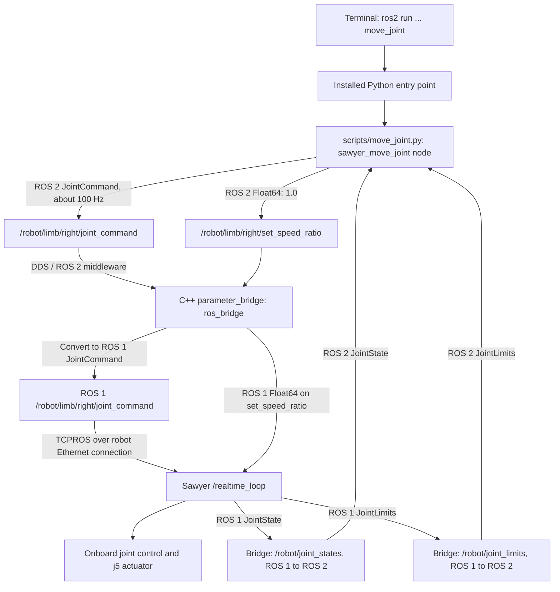

# How `move_joint` reaches Sawyer

This guide traces the current Conda implementation of:

```bash
ros2 run sawyer_ros2_control move_joint --joint right_j5 --position 0.0 --time 5
```

The command starts a Python ROS 2 node on your computer. That node publishes
intermediate joint positions; the existing C++ `ros1_bridge` converts them to
ROS 1 messages consumed by Sawyer's controller. Joint feedback returns through
the bridge so the program can check the result.

## 1. What the arguments mean

| Argument | Meaning |
|---|---|
| `ros2 run` | Find and start an installed package executable. |
| `sawyer_ros2_control` | ROS 2 package containing the application. |
| `move_joint` | Installed Python console entry point. |
| `--joint right_j5` | Put `right_j5` in the command's joint-name array. |
| `--position 0.0` | Absolute target of **0 radians**, rather than a relative displacement. |
| `--time 5` | Generate a five-second position reference. `--duration 5` is equivalent. |

Five seconds describes the trajectory after initialization. Waiting for feedback,
discovering subscribers and applying the speed setting add startup time. Arrival
is checked against measured feedback; five seconds does not guarantee arrival.
If j5 is already within the default tolerance, the program confirms fresh feedback
and exits without publishing commands.

## 2. Command and feedback travel paths



There are two relevant workstation processes: the Python application and the
C++ bridge. The robot's `/realtime_loop` is a separate process onboard Sawyer.
The bridge forwards messages; it does not generate the trajectory or drive motors.

## 3. Environment and bridge preparation

[scripts/env.sh](../scripts/env.sh) establishes isolated runtimes:

| Mode | Environment and workspace used |
|---|---|
| `ros2` | `.conda/envs/humble` and `ros2_ws/install_conda/local_setup.bash`. Runs this Python application. |
| `ros1` | `.conda/envs/noetic` and `ros1_ws/devel_conda/setup.bash`. Runs bridge configuration and preflight. |
| `bridge` | Humble runtime plus selected Noetic paths, ROS 1 custom interfaces and `bridge_ws/install_conda`. Runs the compiled C++ bridge. |

The installed `move_joint` launcher currently uses Humble's Python 3.12 through
its generated shebang. `ros2 run` itself does not activate Conda or source ROS.
The initialized shell supplies the correct package index, Python and library paths.

The robot connection settings come from [config/network.env](../config/network.env):

```text
ROS_MASTER_URI=http://169.254.121.3:11311
ROS_IP=169.254.121.2
ROS_DOMAIN_ID=42
```

`ROS_MASTER_URI` locates the ROS 1 master. The master handles registration and
discovery; command payloads travel over the publisher/subscriber TCPROS connection,
not through the master. `ROS_IP` advertises this workstation's ROS 1 address.
`ROS_DOMAIN_ID` must match between the ROS 2 application and bridge.

The bridge must already be running with `commands:=true`. At bridge startup:

1. [bridge.launch.py](../ros2_ws/src/sawyer_ros2_control/launch/bridge.launch.py)
   starts [configure_bridge.py](../scripts/configure_bridge.py) in the Noetic runtime.
2. The helper reads [config/sawyer_bridge.yaml](../config/sawyer_bridge.yaml).
   `commands:=true` enables the arm command, speed-ratio and command-timeout topic
   entries, which are disabled in the file by default.
3. It writes the topic configuration to ROS 1 parameter `/sawyer_bridge/topics`.
4. After successful configuration, launch starts the existing `parameter_bridge`
   executable in the mixed bridge runtime. It reads that parameter and creates
   the configured subscriptions, publishers and compiled message mappings.

This preparation happens when launching the bridge, not each time you run
`move_joint`. Neither bridge launch nor `move_joint` automatically enables motors.
See the [README operating procedure](../README.md#position-control) before motion.

## 4. How ROS 2 finds the Python file

The executable registration is in
[setup.py](../ros2_ws/src/sawyer_ros2_control/setup.py):

```python
'move_joint = sawyer_ros2_control.move_joint:main'
```

[setup.cfg](../ros2_ws/src/sawyer_ros2_control/setup.cfg) places the generated
launcher under the package's `lib` directory. The execution chain is:

```text
ros2 run
  → find sawyer_ros2_control in the ament package index
  → ros2_ws/install_conda/sawyer_ros2_control/lib/sawyer_ros2_control/move_joint
  → load sawyer_ros2_control.move_joint:main
  → ros2_ws/src/sawyer_ros2_control/sawyer_ros2_control/move_joint.py
  → scripts/move_joint.py
```

The package's `move_joint.py` is a **symlink** to
[scripts/move_joint.py](../scripts/move_joint.py). With the current symlink build,
Python may report a module path under `ros2_ws/build_conda`; resolving that path
reaches the same source file. The installed launcher is generated during build;
edit the source, rather than that launcher.

The local ROS CLI implementation uses `ros2run/command/run.py` and
`ros2run/api/__init__.py` under Humble's `lib/python3.12/site-packages`.
It discovers the executable and starts it as a subprocess with your arguments.

## 5. What `scripts/move_joint.py` does

| Function / method | Role in this command |
|---|---|
| `parse_args()` | Parses j5, absolute target `0.0`, duration `5.0`, and defaults. |
| `main()` | Initializes `rclpy`, constructs `JointMover`, runs it, and performs cleanup. |
| `JointMover.__init__()` | Creates node `sawyer_move_joint`, loads model limits and subscribes to joint feedback and live limits. |
| `on_position()` | Finds j5 in `/robot/joint_states`, checks finite/malformed data and ignores duplicate or older stamped samples. |
| `on_limits()` | Intersects live position/velocity limits with the stored model limits; reads acceleration limits when supplied. |
| `run()` | Waits for feedback, validates the plan, connects command publishers, generates the reference and checks arrival. |
| `quintic_position()` | Computes each smooth intermediate reference position. |
| `publish_position()` | Creates and publishes one ROS 2 `JointCommand`. |
| `save_report()` | Prints measured results and optionally writes a JSON report. |

The model is loaded through the package share directory from
[joint_limits.json](../ros2_ws/src/sawyer_ros2_control/joint_limits.json).
The stored j5 range is `[-2.9761, 2.9761]` radians, with a model velocity limit of
`3.485` rad/s. Live controller limits can make those bounds stricter.

Execution proceeds as follows:

1. Wait up to **10 seconds** for j5 position and usable live limits.
2. Require feedback received within **1 second** and validate the target and
   requested trajectory duration. The selected joint's measured position has a
   fixed half-degree allowance for small limit overshoot; all commanded positions
   must remain strictly inside the allowed range.
3. For an absolute target already reached, observe about **0.2 seconds** of fresh
   feedback and exit without sending commands. `--dry-run` also exits before
   creating command publishers.
4. Create publishers for `joint_command` and `set_speed_ratio`. Wait up to
   **5 seconds** for subscribers on both.
5. Publish `Float64(data=1.0)` on `set_speed_ratio`, then process feedback for
   about **0.2 seconds**. This changes the robot's persistent position-mode speed
   ratio; it is not restored when this program exits. The five-second reference
   still has its own velocity/acceleration duration checks.
6. Refresh the start position and generate the trajectory at about **100 Hz**.
   Scheduling can change the actual number of samples; five seconds is roughly
   500 messages, not an exact count.
7. Check measured arrival, print the JSON result, destroy the node and shut down
   `rclpy`. Default tolerance is `0.008726646` rad (0.5 degrees), and default extra
   settling time is zero. Failure to reach the target produces exit status `1`.

For start angle `q0`, target `q1 = 0.0`, and `u = elapsed / 5`, the reference is:

```text
q(u) = q0 + (q1 - q0) × (10u³ - 15u⁴ + 6u⁵),  0 ≤ u ≤ 1
```

This has zero reference velocity and acceleration at both endpoints. For example,
with a hypothetical start of `0.5` rad, the reference is `0.5` at startup,
`0.25` halfway through and `0.0` at the end. Actual motion is measured separately.
These are repeated **POSITION_MODE** commands, not a ROS trajectory action.

## 6. The message and bridge conversion

Each arm message is built with:

```python
msg = JointCommand()
msg.header.stamp = self.get_clock().now().to_msg()
msg.mode = JointCommand.POSITION_MODE  # 1
msg.names = ['right_j5']
msg.position = [position]             # Current reference, ending at 0.0
self.pub.publish(msg)
```

`velocity`, `acceleration` and `effort` arrays remain empty. The message names only
j5; this program does not publish a seven-joint target vector.

The interface definitions are:

- ROS 2: [ros2_ws/src/intera_core_msgs/msg/JointCommand.msg](../ros2_ws/src/intera_core_msgs/msg/JointCommand.msg).
- ROS 1: [intera_common/intera_core_msgs/msg/JointCommand.msg](../intera_common/intera_core_msgs/msg/JointCommand.msg).

Their matching fields allow automatic bridge generation. The package's
`bridge_mapping.yaml` supplies explicit rules for other messages with renamed
fields; `JointCommand` needs no explicit field-renaming rule.

The C++ receive/convert/publish path is:

1. [parameter_bridge.cpp](../bridge_ws/ros1_bridge/src/parameter_bridge.cpp)
   reads `direction: 2to1` and chooses the `JointCommand` type mapping.
2. [bridge.cpp](../bridge_ws/ros1_bridge/src/bridge.cpp),
   `create_bridge_from_2_to_1()`, creates a ROS 2 subscriber and ROS 1 publisher.
3. [factory.hpp](../bridge_ws/ros1_bridge/include/ros1_bridge/factory.hpp),
   `ros2_callback()`, receives a ROS 2 message, calls `convert_2_to_1()` and
   publishes the resulting ROS 1 message.
4. The compiled generated converter copies the header, mode, names and command
   arrays. Its current generated source is:

   ```text
   bridge_ws/build_conda/ros1_bridge/generated/intera_core_msgs__msg__JointCommand__factories.cpp
   ```

The executable is
`bridge_ws/install_conda/ros1_bridge/lib/ros1_bridge/parameter_bridge`, using the
compiled bridge library. Generated converters are compiled during the bridge
build; the runtime does not read `.msg` or converter source files for each command.

Both sides use `/robot/limb/right/joint_command`, but the ROS types differ:
`intera_core_msgs/msg/JointCommand` on ROS 2 and `intera_core_msgs/JointCommand`
on ROS 1. Configuration requests reliable delivery with queue depth 1 and volatile
durability. The configured ROS 2 subscription includes a 200 ms lifespan value;
this should not be interpreted as an independently verified end-to-end robot
command-age watchdog.

The bridge publishes to the robot's ROS 1 `/realtime_loop` subscriber. Subsequent
motor-control implementation lives onboard Sawyer and is not present in this
repository. Intera SDK's `limb.py` is not called by this command; the application
publishes the compatible messages directly.

## 7. Feedback, safety and stopping

`/robot/joint_states` comes back as `sensor_msgs/JointState` → bridge conversion →
`sensor_msgs/msg/JointState` → `on_position()`. The node compares measured j5 with
the reference while running and with `0.0` at completion. A connected bridge
subscriber confirms a local ROS 2 endpoint; it does not prove controller receipt
or successful physical movement. Measured feedback determines arrival.

**The plain `move_joint` command does not invoke `preflight.py`, require an
operator-approval flag, or monitor full-arm robot readiness/collision topics.**
Its selected-joint data, limit, duration and subscriber checks are narrower than
the separate guarded `command one --execute` application. Follow the README's
preflight procedure before physical use; this guide does not change those checks.

`Ctrl-C` stops this application's publishing and returns exit status `130`.
It does not publish an emergency stop, disable motors, restore the speed ratio,
or configure a robot command timeout. Although the bridge can forward
`joint_command_timeout`, this application does not publish on it. Sawyer's response
after commands cease depends on its onboard controller and existing settings.

## 8. Inspect the path without moving the robot

From the repository root, enter the ROS 2 shell:

```bash
./scripts/env.sh ros2
```

Then inspect the installed executable, source and interfaces:

```bash
ros2 pkg prefix sawyer_ros2_control
ros2 pkg executables sawyer_ros2_control
ros2 run sawyer_ros2_control move_joint --help
readlink -f "$SAWYER_ROOT/ros2_ws/src/sawyer_ros2_control/sawyer_ros2_control/move_joint.py"
ros2 interface show intera_core_msgs/msg/JointCommand
ros2 topic info /robot/limb/right/joint_command --verbose
ros2 topic info /robot/limb/right/set_speed_ratio --verbose
```

With telemetry available, this reads feedback and plans without publishing:

```bash
ros2 run sawyer_ros2_control move_joint --joint right_j5 --position 0.0 --time 5 --dry-run
```

Inspect the robot-side subscriber and uploaded bridge settings separately:

```bash
"$SAWYER_ROOT/scripts/env.sh" ros1 rostopic info /robot/limb/right/joint_command
"$SAWYER_ROOT/scripts/env.sh" ros1 rosparam get /sawyer_bridge/topics
```

The separate ROS 1 process inherits the shell's network settings. No movement is
needed to inspect these files and registrations. This guide was checked against
the current source, installed entry-point resolution and `move_joint --help`;
no robot-motion command was executed to write it.
